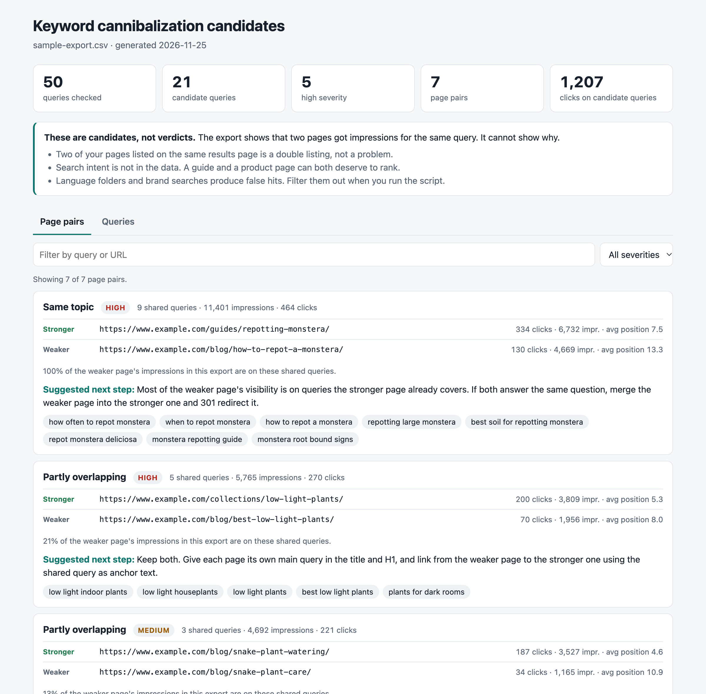
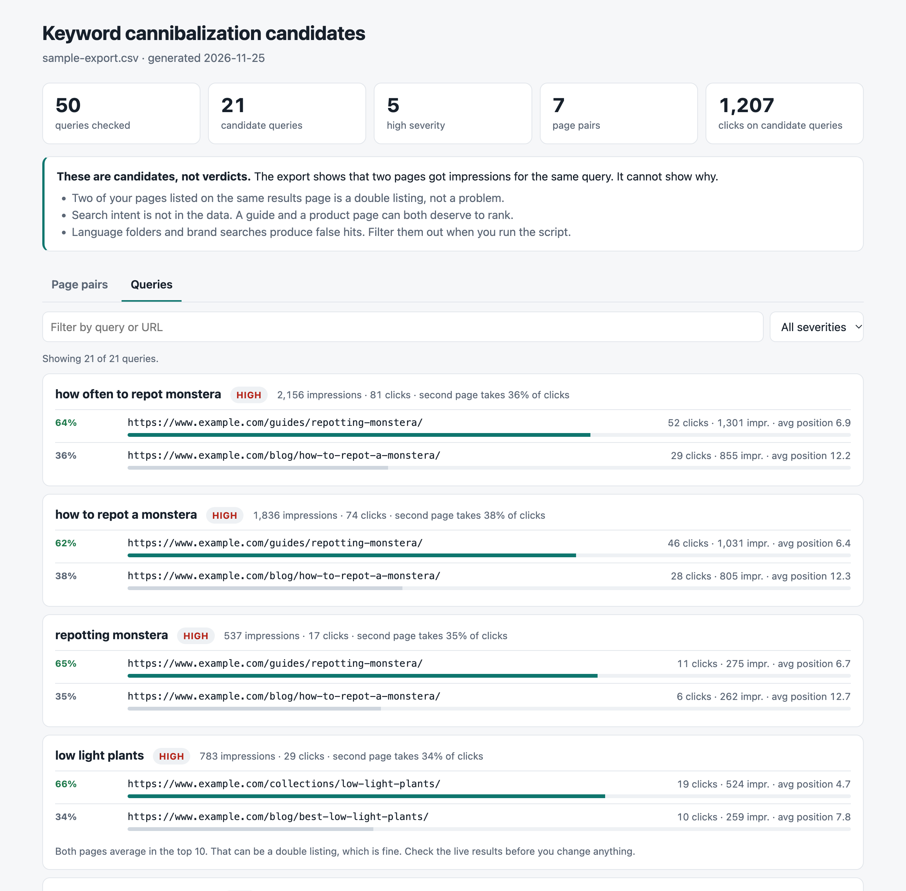

# Keyword Cannibalization Finder: find pages competing for the same query in your Search Console data

A free, open-source Python script that reads a Google Search Console export and lists every query where two or more of your pages share the impressions. You get one HTML report that works offline, plus two CSV files. For each pair of competing pages it shows the shared queries, which page is stronger, how much of the weaker page depends on the overlap, and a suggested next step.

Use it as a keyword cannibalization checker before a content audit, before you merge or redirect old posts, or after a traffic drop when you suspect two pages are splitting one topic.



> The screenshots and the files in `examples/` come from a **made-up export** for a made-up houseplant shop on `example.com`. None of it is real data.

## What you get

- **Page pairs:** every two pages that collide, ranked by how many queries they share. Each pair is labelled *Same topic*, *Partly overlapping* or *One-off overlap*, with a suggested next step for each.
- **Queries:** every query with two or more competing pages, the share each page takes, clicks, impressions and average position.
- **Severity** (high, medium, low) from how much the second page takes away from the first.
- **A "double listing" note** when both pages average in the top 10, so you do not merge two pages that are both doing their job.
- **Brand and folder filters** to remove the two most common false hits: brand searches with sitelinks, and language folders.
- **URL clean-up:** `http` and `https`, a trailing slash and `#section` links count as one page.
- **`queries.csv` and `pairs.csv`** with every row, for a spreadsheet or a ticket.

One HTML file, no CDN, no fonts to download, light and dark mode, works on a phone.



## Quick start

You need Python 3.9 or newer. There is nothing to install: the script uses the standard library only.

Download this repo (Code > Download ZIP, or `git clone`), open a terminal in the folder and try it on the sample data:

```bash
python find.py examples/sample-export.csv --out examples/sample-report --brand leafmoor --exclude "/fr/"
```

Open `examples/sample-report/cannibalization.html` in a browser.

Then run it on your own export:

```bash
python find.py my-export.csv --out report --brand "your brand, your other brand name"
```

## Getting the right export

The script needs **the query and the page on the same row**. The normal download from the Search Console Performance report does not have that: it gives you `Queries.csv` and `Pages.csv` as two separate lists. Here are three ways to get the combined file.

### 1. Data Studio (formerly Looker Studio), free, no code

1. In Data Studio, create a data source with the **Search Console** connector. Choose your site, and in the Tables panel choose **URL Impression**. (Site Impression does not have the page.)
2. Create a report from it and add a **table** chart with two dimensions, **Query** and **Landing Page**, and the clicks, impressions and average position metrics.
3. Set the date range. Three months is a good start.
4. In the table's Style tab turn on **Show pagination**. With it on, the export contains every row and not only the rows on screen.
5. Switch to view mode, open the table's **More options** menu, choose **Export data**, then **CSV**.

Google documents a limit of 750,000 rows per chart export. The steps above follow Google's help pages for [the Search Console connector](https://docs.cloud.google.com/data-studio/connect-to-search-console) and for [exporting data from a chart](https://docs.cloud.google.com/data-studio/export-data-from-a-chart).

### 2. The Search Console API

Request the `query` and `page` dimensions together in a Search Analytics query and save the rows as a CSV with query, page, clicks, impressions and position columns. Any API client or script that does this will work. This repo does not include one.

### 3. The BigQuery bulk export

If your property exports to BigQuery, select the query, URL, clicks and impressions from the URL-level table and download the result as CSV. Position is optional.

### Column names

Headers are matched by name, ignoring case, spaces and punctuation:

| Column | Recognised headers |
|---|---|
| Query | Query, Queries, Top queries, Keyword, Search query, Search term |
| Page | Page, Pages, Top pages, Landing Page, URL, Address |
| Clicks | Clicks, Url Clicks, Total clicks |
| Impressions | Impressions, Impr, Url Impressions |
| Position (optional) | Position, Average Position, Avg Position |

If your file uses other names, the error message lists the columns it found. Name yours with `--query-col`, `--page-col`, `--clicks-col`, `--impressions-col` and `--position-col`.

Other columns are ignored. If the file has one row per date, country or device, the rows for the same query and page are added up, and position is averaged by impressions.

The reader also handles a byte order mark, UTF-16 files, comma, semicolon and tab separators, numbers such as `1,234` and `1.234`, and decimal commas such as `7,5`.

## How it decides

A query becomes a candidate when at least two pages each pass all three tests:

1. The query has **50 or more impressions** in total (`--min-impressions`).
2. The page has **10 or more impressions** on that query (`--min-page-impressions`).
3. The page has **10% or more** of the query's impressions (`--min-share`).

Then, for each candidate:

- **Share:** each page's share of clicks when the competing pages have 10 or more clicks between them (`--click-basis`). Below that, clicks are too few to trust, so it uses the share of impressions.
- **Stronger page:** the one with the biggest share. Ties go to the other measure, then to the better position. Page pairs use the same rule across all their shared queries.
- **Severity:** *high* when the second page takes 30% or more (`--high`), *medium* from 15% (`--medium`), *low* below that.

And for each pair of pages:

| Label | Rule | Suggested next step |
|---|---|---|
| Same topic | 3 or more shared queries, and at least half of the weaker page's impressions in the export are on those queries | If both pages answer the same question, merge the weaker one into the stronger one and 301 redirect it |
| Partly overlapping | 3 or more shared queries, but the weaker page has plenty of impressions elsewhere | Keep both, give each its own main query in the title and H1, link from the weaker to the stronger |
| One-off overlap | 1 or 2 shared queries | A link from the weaker page to the stronger one is usually enough |

Change the two cut-offs with `--same-topic-queries` and `--same-topic-overlap`.

## Options

| Flag | What it does |
|---|---|
| `--out` | Output folder. Default `report`. |
| `--brand` | Comma-separated brand terms. A query that contains one is skipped. |
| `--exclude` | Regex. Pages that match are ignored, for example `"/fr/\|/de/"`. |
| `--include` | Regex. Only pages that match are read, for example `"/blog/"`. |
| `--min-impressions` | Impressions a query needs in total. Default 50. |
| `--min-page-impressions` | Impressions a page needs on the query. Default 10. |
| `--min-share` | Share of the query's impressions a page needs. Default 0.10. |
| `--high`, `--medium` | Second page's share for high and medium severity. Defaults 0.30 and 0.15. |
| `--click-basis` | Clicks from which shares use clicks and not impressions. Default 10. |
| `--same-topic-queries` | Shared queries from which a pair is more than a one-off. Default 3. |
| `--same-topic-overlap` | Share of the weaker page's impressions from which a pair is the same topic. Default 0.50. |
| `--strip-params` | Treat URLs that differ only by `?parameters` as one page. |
| `--keep-fragments` | Treat `page#section` URLs as separate pages. |
| `--max-rows` | Queries and pairs embedded in the HTML. Default 500. The CSV files always have all of them. |
| `--query-col`, `--page-col`, `--clicks-col`, `--impressions-col`, `--position-col` | Exact header of a column that is not detected. |

Shares accept `0.3` or `30`.

## What the data cannot tell you

The report lists **candidates, not verdicts**. Check each one before you merge or redirect anything.

- **A double listing is not a problem.** If both pages sit on the first results page for the same query, you hold two spots. The report adds a note when both pages average in the top 10. Look at the live results first.
- **Search intent is not in the export.** A buying guide and a product page can both deserve to rank for the same words. Read both pages.
- **Averages hide swaps.** Average position cannot show two pages taking turns from day to day. If a pair looks serious, compare both pages by date in Search Console.
- **Hidden queries are missing.** Search Console leaves out rare queries for privacy, and some exports group them into a row with an empty query. Those rows can never be a candidate, but their impressions still count towards the page's total, so the overlap percentage is not overstated. The report footer says how many there were.
- **Brand searches and language folders give false hits.** Use `--brand` and `--exclude`.
- **Short date ranges give thin numbers.** Export at least one month, three if you can. On a small site you can lower `--min-impressions`, but read the results with more doubt.

## What was tested

- The sample export in `examples/`, which you can rebuild with `python examples/make_sample.py`.
- 20 unit tests for the file reader, the rules and the HTML output: `python -m unittest discover tests`.
- A made-up file of 120,000 rows with a date column. It ran in about 7 seconds on a laptop and wrote a 0.7 MB HTML report.
- Python 3.9.

**Not tested:** a real export from Data Studio, the API or BigQuery. The reader was written for the documented fields and for the usual CSV quirks, but it has only been run on made-up files. If a real export trips it, the column flags above are the way around, and an issue with the header row (no data needed) is welcome.

## Privacy

The script runs on your computer and makes no network requests. The HTML report loads nothing from the internet: no scripts, fonts or trackers. Your queries and URLs are written into the report and the CSV files, so treat those files like the export itself. The `.gitignore` keeps exports and reports out of git.

## FAQ

**What is keyword cannibalization?**
Two or more pages on the same site that target the same search query. Google has to pick one, the clicks and links are split between them, and often neither ranks as well as one clear page would.

**How do I fix keyword cannibalization?**
Pick the page that should win. Then choose one of three fixes: merge the other page into it and redirect, rewrite the other page for a different query, or keep both and link from the weaker page to the stronger one with the query as anchor text.

**Why does the standard Search Console export not work?**
It lists queries and pages separately, so you cannot see which page showed for which query. Cannibalization only shows up when both are on the same row.

**Does it work with exports from other SEO tools?**
Any CSV with a query, a page, clicks and impressions on each row can be read. Rank trackers that report one URL per keyword will not show cannibalization, because the second page is already missing from the data.

## License

MIT. See [LICENSE](LICENSE).
